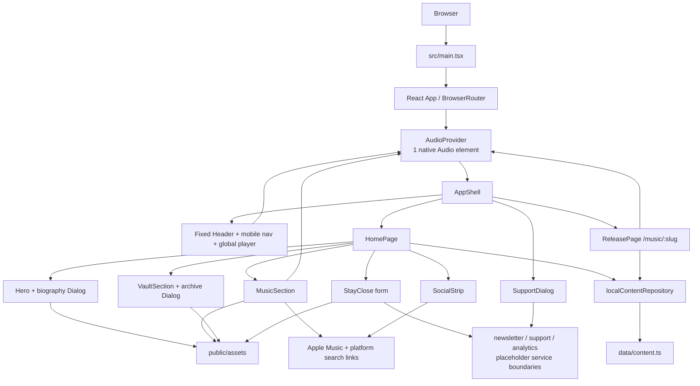

# Current-State Website Audit

**Project:** Jona Ferreira — direct-to-fan V1  
**Audit date:** 2026-10-23  
**Scope:** Current repository, rendered SPA, interaction tests, responsive QA artifacts, and implementation evidence.  
**Method:** Read-only code inspection plus local browser verification. No production code or behavior was changed for this audit.

## Executive summary

### What the product is today

This is a single-artist, desktop-first direct-to-fan music site for Jona Ferreira. The current experience is a visually-led one-page homepage with:

- Hero portrait, short biography, featured single, and social links.
- A six-release music carousel with local 30-second previews, shared playback controls, streaming links, and provisional release routes.
- A four-item “Vault” preview for unreleased/behind-the-scenes content. Items are presented as coming soon; no fulfillment exists.
- A “Stay Close” email capture form. Validation is implemented, but the newsletter provider is intentionally not connected.
- Support amount selection. The UI is implemented, but secure checkout is intentionally not connected.

The app is a client-rendered React SPA. Content is typed but stored locally in TypeScript fixtures. There is no backend, CMS, authentication, database, payment provider, newsletter provider, analytics provider, server-rendered SEO, or release-specific social metadata in the repository.

### Current architecture

`src/main.tsx` bootstraps React and fonts; `src/app/App.tsx` owns routing, the shell, content loading, and global dialogs; `AudioProvider` owns one native audio element and exposes playback through context. The homepage composes feature sections from a local repository adapter. `src/services/` contains explicit seams for future newsletter, support, and analytics integrations, but each current implementation is a no-op or honest unavailable response.

### Current user experience

Visitors land on a full-viewport hero, can open a focus-managed biography dialog, jump to music/Vault/Stay Close, play local previews from either the music section or fixed header player, open Apple Music, inspect future Vault items, attempt support, and attempt newsletter signup. All unavailable backend actions return explicit “not connected yet” messaging rather than implying success.

### Strongest implementation areas

- One shared audio engine synchronizes the music section, header player, release routes, progress range, and waveform state.
- Typed domain models and a `ContentRepository` boundary make the current local fixtures replaceable without feature components importing them directly.
- Dialog behavior includes a portal, Escape dismissal, body scroll lock, focus entry, focus trapping, and focus restoration.
- Responsive CSS has explicit desktop/tablet/mobile behavior and the existing browser QA covers mobile navigation and overflow.
- The implementation has honest integration boundaries and distinguishes provisional UI from real fulfillment.

### Current limitations

- All content is for one artist and all assets are local; there is no tenant, user, admin, CMS, or server authorization model.
- Newsletter, payment/checkout, Vault access/fulfillment, and analytics are placeholders.
- The release page is explicitly provisional and has only minimal editorial content.
- Only Apple Music links are populated per release; other platform fields are modeled but empty. Social links mostly point to platform searches rather than verified artist profiles.
- The waveform is decorative CSS bars, not audio analysis.
- The SPA has only static document metadata; no canonical URL, OG/Twitter cards, sitemap, robots file, structured data, or per-release server metadata.
- Automated unit tests currently cannot start in this host because the installed jsdom dependency chain hits a CommonJS/ESM incompatibility under the available runtime. Browser flows pass when run with installed Chrome.

### Platform readiness

The typed `Artist`, `MusicRelease`, and `VaultItem` models, stable IDs/slugs, repository interface, and service interfaces are the clearest current seams for future database/CMS work. Feature components already consume resolved content in several places. However, the application remains tightly coupled to Jona in route calls, social URLs, copy, static asset paths, the hard-coded artist slug, support copy, the single featured-release assumption, and global styling/content assumptions. This is a useful V1 content boundary, not yet a multi-artist platform architecture.

## 1. Repository and project overview

### Important directory tree

```text
.
├── index.html                     Static SPA shell and global metadata
├── package.json / package-lock.json
├── vite.config.ts                 Vite + React + Tailwind Vite plugin + Vitest config
├── playwright.config.ts           Browser test server and viewport defaults
├── eslint.config.js
├── tsconfig.json
├── scripts/
│   └── visual-qa.mjs              Screenshot, image, geometry, overflow checks
├── tests/
│   └── experience.spec.ts         Five browser-level experience flows
├── public/assets/                 Local imagery, SVG UI/social assets, six M4A previews
├── artifacts/qa/                  Existing visual captures and results.json
└── src/
    ├── main.tsx                   React entry point and font/style imports
    ├── app/
    │   ├── App.tsx                BrowserRouter, shell, routes, content loading
    │   ├── AudioProvider.tsx       Shared native audio engine
    │   ├── audioContext.ts         Audio context contract and status type
    │   └── AudioProvider.test.tsx  Audio provider unit tests
    ├── components/
    │   ├── Header.tsx              Fixed navigation and global player
    │   ├── Waveform.tsx            Decorative waveform bars
    │   ├── Dialog.tsx              Shared modal/focus behavior
    │   └── SupportDialog.tsx       Support amount UI and checkout seam
    ├── features/
    │   ├── hero/Hero.tsx
    │   ├── music/MusicSection.tsx
    │   ├── vault/VaultSection.tsx
    │   └── stay-close/StayClose.tsx
    ├── domain/types.ts             Artist, release, Vault, repository contracts
    ├── data/content.ts             Typed Jona fixtures
    ├── repositories/
    │   └── localContentRepository.ts
    ├── services/                   Newsletter, support, analytics seams
    ├── hooks/                      useAudio and GSAP section reveal hook
    └── styles/
        ├── tokens.css              Semantic colors, typography, geometry, motion tokens
        └── globals.css              Full component/layout CSS and media queries
```

### Entry points and bootstrapping

`src/main.tsx:14-18` calls `ReactDOM.createRoot`, wraps `<App />` in `React.StrictMode`, and imports the Fontsource CSS, design tokens, and global CSS. `index.html` supplies the root element and static metadata.

`src/app/App.tsx:203-211` wraps the product in `BrowserRouter` and `AudioProvider`. `AppShell` renders the fixed `Header`, route content, and the global support dialog. `HomePage` asynchronously resolves artist, releases, and Vault content from `localContentRepository`.

### Configuration and environment strategy

There is no `.env` usage, runtime configuration module, API base URL, or provider key in the inspected source. The only environment reads are test/browser executable overrides in `playwright.config.ts` and `scripts/visual-qa.mjs` (`PLAYWRIGHT_CHROMIUM_EXECUTABLE`). URLs and content are local fixture values or hard-coded external links.

### Styling and animation architecture

- CSS is primarily handwritten in `src/styles/globals.css`, with semantic custom properties in `src/styles/tokens.css`.
- Tailwind v4 is imported through `@import "tailwindcss"`, and the Vite Tailwind plugin is installed, but the product UI is expressed almost entirely through custom class selectors rather than utility classes.
- Fontsource self-hosts Archivo, Geist Mono, Instrument Serif, and Sofia Sans Extra Condensed via imports in `src/main.tsx`.
- GSAP + `@gsap/react` + `ScrollTrigger` implement section reveal motion in `useSectionMotion.ts`.
- CSS transitions/keyframes implement feedback, waveform pulsing, button press, and spinner motion.
- No `requestAnimationFrame`, Web Audio API, or audio analyser is used.

## 2. Technology stack and dependencies

### Runtime stack

| Area | Current implementation |
|---|---|
| Runtime requirement | Node `>=22.12.0` in `package.json`; audit host reported Node `22.9.0` |
| Framework | React `19.3.1` |
| Language | Strict TypeScript `6.0.3`, JSX transform `react-jsx` |
| Build/dev | Vite `7.3.7`, `@vitejs/plugin-react` |
| Routing | React Router DOM `7.18.4`, using `BrowserRouter`, `Routes`, `Route`, `Link`, `useLocation`, and `useParams` |
| Styling | Custom CSS tokens/layout; Tailwind CSS `4.3.3` plugin/import present |
| Icons | `lucide-react` `1.60.0` plus local SVG icons |
| Motion | GSAP `3.15.0`, `@gsap/react` `2.1.2`, ScrollTrigger |
| Audio | Native browser `HTMLAudioElement` created with `new Audio()` |
| Testing | Vitest `5.0.5`, Testing Library React `16.3.3`, jsdom `30.1.3`, Playwright `1.64.1` |
| Formatting/lint | Prettier `3.9.10`, ESLint `10.13.0`, typescript-eslint, React hooks/refresh plugins |
| Package manager | npm, lockfile `package-lock.json` |

### Significant dependencies

| Dependency | Version | Purpose / observed use |
|---|---:|---|
| `react`, `react-dom` | 19.3.1 | UI and DOM rendering; used in `main.tsx` and all components |
| `react-router-dom` | 7.18.4 | SPA routes and navigation in `App.tsx`, `Header.tsx`, `Hero.tsx`, `MusicSection.tsx` |
| `gsap` | 3.15.0 | `ScrollTrigger` reveal animations in `useSectionMotion.ts` |
| `@gsap/react` | 2.1.2 | `useGSAP` lifecycle integration |
| `lucide-react` | 1.60.0 | Menu, close, arrows, play/pause, loading, retry icons |
| `tailwindcss`, `@tailwindcss/vite` | 4.3.3 | Build integration and base import; no meaningful utility-class usage found in feature markup |
| `@fontsource/*` | 5.3.0 | Self-hosted font CSS and font files for the four declared families |
| `@playwright/test` | 1.64.1 | Five browser flows and QA script browser runtime |
| `vitest`, Testing Library, jsdom | 5.0.5 / 16.3.3 / 30.1.3 | Audio provider unit tests; current host run failed before test execution due an ESM/CJS jsdom dependency error |
| ESLint/Prettier toolchain | current lockfile versions | Static quality and formatting checks |

No dependency was removed or installed. No clearly unused product runtime dependency was found, although Tailwind appears to be infrastructure rather than the main styling authoring approach. `@types/node`, ESLint packages, and test packages are development-only as expected.

## 3. Application architecture

### Conceptual hierarchy

```text
React root (StrictMode)
└── BrowserRouter
    └── AudioProvider
        └── AppShell
            ├── Header
            │   ├── Logo/link
            │   ├── Section navigation
            │   ├── Support CTA
            │   ├── Global player popover
            │   └── Mobile menu
            ├── Routes
            │   ├── / → HomePage
            │   │   ├── Hero + biography Dialog
            │   │   ├── SocialStrip
            │   │   ├── MusicSection + local preview controls
            │   │   ├── VaultSection + archive Dialog
            │   │   └── StayClose + newsletter form
            │   ├── /music/:slug → ReleasePage
            │   └── * → not-found page
            └── SupportDialog (global portal)

Content
├── ContentRepository interface
├── localContentRepository
└── typed fixtures in data/content.ts

External seams
├── newsletterService (currently unavailable response)
├── supportService (currently null)
└── analytics (currently no-op)
```

### State ownership

- Global audio state: `AudioProvider` (`release`, `status`, `currentTime`, `duration`, `error`) exposed by `AudioContext`.
- Shell state: `AppShell` owns the selected support dialog context; `Header` owns player-open, mobile-open, and active-section state.
- Homepage content state: `HomePage` owns the asynchronously resolved artist/releases/Vault object.
- Section state: `Hero` owns biography open/photo index; `MusicSection` owns selected release/menu open; `VaultSection` owns archive dialog; `StayClose` owns form value/status/message.
- No Redux, Zustand, server cache, URL query state, or persisted client storage is used.

## 4. Routes and views

| Route | Purpose and current behavior |
|---|---|
| `/` | Main direct-to-fan homepage. Loads local artist, six releases, and four Vault items asynchronously; supports hash jumps to `#music`, `#vault`, and `#stay-close`. |
| `/music/:slug` | Release detail route. Resolves a release by slug, displays artwork/date, shared preview control, verified Apple Music link when present, and a provisional note. |
| Unknown path | Generic “PAGE NOT HERE.” state with a link home. |
| Unknown `/music/:slug` | “RELEASE NOT FOUND” state with “Back to music.” |

All content is client-rendered. There are no conventional server pages, API routes, loaders, or nested layouts beyond `AppShell`.

## 5. Top-to-bottom visual and interaction walkthrough

### Fixed header/navigation

`src/components/Header.tsx` renders a fixed header with the wordmark, desktop anchors, support CTA, waveform player trigger, and mobile menu trigger. At widths above 760px the nav is horizontal; at `max-width: 760px` it becomes an absolute full-width dropdown beneath a 74px header. On the homepage, an `IntersectionObserver` watches `music`, `vault`, and `stay-close` with `rootMargin: "-30% 0px -50% 0px"` and updates the active underline state. On release routes, links point back to `/#section`.

The header player popover is click-outside/Escape dismissible. It shows current artwork/title, play/pause/retry, a labeled range input, current/duration times, and errors. It is the same audio context used below the fold.

### Hero

`Hero.tsx` renders the high-priority portrait (`fetchPriority="high"`), a dark gradient, large display heading, short bio, “READ MORE,” and a featured release card linking to `/music/accion`. Desktop layout uses a 920px hero height in the current QA capture; mobile uses 780px and a taller art crop with the content repositioned around the center.

The biography dialog is a portal-backed modal. It reuses the one hero image with two crop states, contains full biography copy, has previous/next controls, and links back to `#music`. The `Dialog` component manages Escape, click-outside, focus trapping, body scroll lock, and restoration to the trigger.

### Social strip

The strip is a bordered, 96px desktop band and a wrapping mobile band. It provides external links to Instagram, TikTok, YouTube, Spotify, and Apple Music. The first four are search URLs labeled as searches for assistive technology; Apple Music is an exact artist profile URL.

### Music / “La Musica”

`MusicSection.tsx` is a stateful release carousel. The current release starts at the first fixture (`Acción`); previous/next artwork and circular arrows wrap around the six-item array. The release tab row selects any release; on mobile it horizontally scrolls.

The section displays release title/date, preview play state, a streaming dropdown, a release-page link, the active artwork, neighboring artwork, current status chip, and an approximate “1 / 3” grouping indicator derived from the selected index. “Listen on” renders only populated `streamingLinks`; currently that is Apple Music for all six fixture releases.

Play, pause, track changes, error/retry, and progress are shared through `AudioProvider`. Selecting a release changes the visible selection but does not itself play it. Selecting a different release while another is playing changes the active UI selection; playback changes only when its play action is invoked.

### The Vault

`VaultSection.tsx` renders four configured items: two large cards and a two-card stack. Cards are buttons, lazy-load their images, show label/title/description/support amount, and include a decorative 104-bar waveform for audio items. Every item currently has `coming-soon` data, but the card’s accessible label states “coming soon” regardless of the status field.

Selecting a card opens the global support dialog with the item title. “See the rest of the vault.” opens an archive dialog explaining that the remaining archive pieces are being prepared and that secure checkout is not ready.

### Stay Close

`StayClose.tsx` renders the signup promise, a wallpaper incentive, a labeled email input, helper text, status region, CTA, reward artwork, and footer divider. Client-side validation accepts a simple `name@domain.tld` pattern. Valid input calls `newsletterService.subscribe`; the current implementation always returns an unavailable error and does not store or transmit the address. The form resets its displayed status when the user edits after a non-loading state.

### Release page

`ReleasePage` in `App.tsx` is intentionally provisional. It has a back link, artwork, “single” label, localized date, shared preview button, Apple Music link, and note that full editorial content is pending approved design. It does not have release descriptions, lyrics, credits, related content, SEO data, or a full media player layout.

## 6. Audio architecture deep dive

### Architecture map

```text
content.ts MusicRelease.previewUrl
        ↓
MusicSection / ReleasePage / Header
        ↓  play(), toggle(), seek()
AudioContext + useAudio()
        ↓
AudioProvider
  └── one HTMLAudioElement from new Audio()
       ├── src assignment and currentTime reset on track switch
       ├── play()/pause()
       ├── timeupdate → currentTime
       ├── loadedmetadata → duration
       ├── ended → paused
       └── error → error status/message
        ↓
shared UI state
├── Music play button / status chip
├── Header waveform + player popover
├── ReleasePage play button
└── progress range / time labels
```

### Playback lifecycle

1. A user presses a release play button, the release-page play button, or the header player control.
2. `MusicSection` or `ReleasePage` calls `audio.play(release)`; `Header` calls `audio.toggle()` for the current release.
3. `AudioProvider.play()` increments `playRequestRef`, validates the shared element and preview URL, pauses the prior source, assigns a new `src` when needed, resets time/duration, sets the release and `loading`, then awaits `audio.play()`.
4. A successful play sets `playing` if the request is still current. A rejected play sets `error` with a retry-oriented message.
5. Native `timeupdate` updates `currentTime`; `loadedmetadata` updates finite duration; `ended` changes status to `paused`; `error` sets an explicit error state.
6. `seek()` clamps the requested time to `0..duration` and writes through to the native element.
7. On provider unmount, the element is paused, listeners are removed, and the ref is cleared.

### Important current characteristics

- There is one native audio element for the whole mounted app, so play controls are synchronized across the homepage, header, and release pages.
- The provider is mounted above routes, so route changes do not destroy the audio engine.
- The source is `preload = "none"`; no preview bytes are requested until play is attempted.
- There is no explicit queue, autoplay, crossfade, repeat, volume, mute, or next-track-on-ended behavior. Track end only changes status to paused.
- There is no mobile-specific audio workaround beyond calling `play()` from a user-initiated button. Browser autoplay policy is therefore naturally respected, and rejected promises are surfaced.
- `Waveform.tsx` uses a fixed list of bar heights and CSS `pulse-bar` animation. It reflects `status === "playing"`, but is not computed from audio amplitude or waveform data.
- When metadata has not loaded, the header range uses a 30-second fallback; all fixture previews are described as 30-second previews.
- The `playRequestRef` prevents an older asynchronous play request from overwriting a newer request’s status.

The dedicated `AudioProvider.test.tsx` covers initial idle state, play, metadata/time updates, pause/resume, seeking, track switching, ended/error events, and a rejected play retry. The test design reflects the intended lifecycle even though the current host could not start Vitest.

## 7. Design system and visual language

### Tokens

`src/styles/tokens.css` defines:

| Category | Current values |
|---|---|
| Backgrounds | `--ink-0: #0b0a0a`, `--ink-2: #131111`, `--ink-3: #1c1918` |
| Foregrounds | `--bone-0: #f2ece3`, `--bone-soft: #d8d0c4`, `--bone-1: #bdb4a8`, `--bone-2: #8c847a` |
| Accents | `--red-action: #c62127`, `--red-text: #ff6a5c`, `--green-unlocked: #8fd3a6`, `--lime-support: #adf100` |
| Interaction | `--lime-support-hover: #9bd800`, `--state-hover: #f2ece30f` |
| Lines/glass | `--line-hairline: #f2ece31a`, `--line-glass: #f2ece329`, `--line-control: #f2ece333`, `--glass-ink: #0b0a0ab8`, `--glass-surface: #13111180` |
| Geometry | `--container: 1280px`, `--gutter: clamp(20px, 5.55vw, 80px)` |
| Motion | 180ms feedback, 400ms component, 700ms cinematic; cubic-bezier `.2,.7,.2,1` |
| Fonts | Sofia Sans Extra Condensed display, Instrument Serif editorial italic, Archivo body, Geist Mono labels |

The visual language is dark, editorial, and music-poster-like: large condensed uppercase headings are paired with italic serif words, bone typography sits over near-black surfaces, red/coral marks metadata, and lime is reserved for direct-support actions. Photography, artwork, hairline borders, dark gradients, and sparse controls carry most of the atmosphere. Cards use small radii or square edges; lime support buttons are pill-shaped.

### Typography and spacing

`.display-heading` uses `clamp(64px, 7vw, 100px)` and tight line-height; editorial headings use separate condensed/serif spans with responsive overrides. Body copy uses Archivo; eyebrow/metadata uses Geist Mono with uppercase tracking. The container is capped at 1280px with fluid gutters, while mobile fixes gutters to 20px. Repeated spacing is mostly explicit CSS values rather than a named spacing scale.

## 8. Component inventory

| Component | Path | Responsibility / state | Reuse |
|---|---|---|---|
| `App` / `AppShell` | `src/app/App.tsx` | Providers, routes, global support-dialog state, content loading | App-specific shell |
| `Header` | `src/components/Header.tsx` | Fixed nav, active section observer, mobile menu, global audio popover | Global/reusable |
| `Dialog` | `src/components/Dialog.tsx` | Portal, modal semantics, focus trap/restore, Escape, scroll lock | Shared modal primitive |
| `SupportDialog` | `src/components/SupportDialog.tsx` | $5/$15/$30 amount selection and checkout response | Reusable support flow shape; copy is artist-specific |
| `Waveform` | `src/components/Waveform.tsx` | Fixed decorative bars, optional active animation | Reusable visual primitive |
| `Hero` | `src/features/hero/Hero.tsx` | Artist hero, featured release, biography modal | Structured for artist/release props, but copy/social assumptions remain |
| `SocialStrip` | `src/features/hero/Hero.tsx` | Hard-coded social platform list and links | Could be extracted/configured |
| `MusicSection` | `src/features/music/MusicSection.tsx` | Carousel, release selection, preview, streaming menu | Reusable with `MusicRelease[]` |
| `VaultSection` / `VaultCard` | `src/features/vault/VaultSection.tsx` | Vault grid/cards, item support dialog, archive dialog | Reusable with `VaultItem[]` |
| `StayClose` | `src/features/stay-close/StayClose.tsx` | Newsletter form and reward visual | Form pattern reusable; copy/art fixed |
| `AudioProvider` | `src/app/AudioProvider.tsx` | Single native audio engine and global state | Strong shared infrastructure |
| `localContentRepository` | `src/repositories/localContentRepository.ts` | Async adapter over local fixtures | Intended replacement boundary |

## 9. Data and content architecture

### Current data shapes

```ts
interface Artist {
  id: string;
  slug: string;
  displayName: string;
  biography: { short: string; full: string };
  heroImage: string;
  featuredReleaseId: string;
}

interface MusicRelease {
  id: string;
  artistId: string;
  slug: string;
  title: string;
  releaseDate: string;
  artworkUrl: string;
  previewUrl?: string;
  featured: boolean;
  streamingLinks: Partial<Record<"spotify" | "appleMusic" | "youtube" | "amazonMusic", string>>;
}

interface VaultItem {
  id: string;
  artistId: string;
  slug: string;
  title: string;
  type: "audio" | "video" | "image" | "download";
  label: string;
  description: string;
  artworkUrl: string;
  supportAmount: number;
  status: "coming-soon" | "available";
}
```

`src/data/content.ts` contains one artist, six releases, and four Vault items. `src/repositories/localContentRepository.ts` exposes asynchronous methods and filters records by artist ID/slug. Components receive resolved values and do not import fixture arrays directly, which is a positive current boundary.

There is no JSON content layer, API response normalization, CMS schema, media upload, database, local storage, or environment-driven content. Social links are a hard-coded array in `Hero.tsx`; support amounts are both fixture data and hard-coded dialog options; newsletter copy and reward art are JSX/static asset references.

## 10. Backend, integrations, and CMS readiness

### Implemented today

- Client-side route handling with React Router.
- Local static asset delivery from `public/assets`.
- Native browser audio playback of local M4A files.
- External link navigation to Apple Music and platform search pages.
- Client-side email format validation.
- Explicit service interfaces for newsletter, support, and analytics.
- Browser/test-only local server and visual QA tooling.

### Placeholder or not implemented

- `newsletterService.subscribe()` always returns `{ ok: false, message: ... }`; no request is made.
- `supportService.createCheckout()` always returns `null`; no payment data is collected.
- `analytics.track()` is a no-op; there is no provider or event sink.
- Vault items are all `coming-soon`; no unlock, authentication, download, video, or delivery exists.
- No API routes, REST, GraphQL, serverless functions, Supabase, Firebase, auth, storage, CMS, database, or server-side authorization were found.

### CMS readiness observations

Good existing seams:

- Stable IDs/slugs and explicit artist ownership fields already exist.
- `ContentRepository` gives the UI an adapter boundary.
- Release/Vault components accept arrays and render from data.
- Media URLs are data fields rather than imported image modules.
- Service interfaces isolate newsletter, checkout, and analytics integrations.

Tightly coupled areas:

- `HomePage` calls `getArtistBySlug("jona-ferreira")`, and all repository reads are hard-coded to that slug.
- Copy, social destinations, featured release messaging, “Jona,” “La Cultura,” and reward language are embedded in JSX.
- `Hero` assumes one specific artist portrait and a two-crop biography interaction.
- Header metadata says “Jona Ferreira · 30-second preview”; support dialog and footer copy are artist-specific.
- `index.html` title/description are static and not data-driven.
- There is no tenant context, authoring role, draft/publish state, media lifecycle, or content validation beyond TypeScript compilation.

## 11. Responsiveness

### Explicit breakpoints

- `max-width: 1100px`: reduces header height/nav gaps, broadens hero art, scales music artwork, adjusts Vault typography, and narrows the Stay Close form.
- `max-width: 760px`: mobile header/menu, 74px header, mobile hero art/content, stacked music layout, horizontally scrollable release tabs, mobile Vault grid, stacked form/dialog layouts.
- `max-width: 480px`: one-column Vault cards, full-width join button, smaller reward art, tighter mobile Vault behavior.
- `prefers-reduced-motion: reduce`: disables smooth scrolling, effectively removes transitions/animations, and stops waveform animation.

### Tested/observed widths

The current `visual-qa.mjs` run measured no horizontal overflow at 390, 1024, 1280, 1440, 1600, or 1920px; all measured `scrollWidth` values equaled the viewport width and page errors were empty. The browser interaction suite specifically checks 390px mobile menu reachability and hash navigation. The implementation’s 768px behavior is governed by the 760px breakpoint: a 768px viewport remains in the pre-mobile layout, while 760px and below use the mobile layout. The requested 1440px and 390px experiences were also inspected visually in the browser; the existing QA artifacts contain section captures and full-page screenshots.

Responsive behavior by area:

- Navigation: desktop horizontal links/support CTA; mobile hamburger dropdown with mobile support CTA.
- Hero: desktop portrait fills hero; mobile uses a taller, centered crop and moves copy lower.
- Music: desktop two-column artwork/details composition; mobile column-reverse layout with centered active art and horizontally scrollable tabs.
- Vault: desktop asymmetric grid; mobile first full-width card followed by stacked cards, then single-column under 480px.
- Forms: desktop constrained horizontal form; mobile full-width stacked CTA.
- Dialogs: biography becomes a vertical photo/copy layout; support/archive dialogs reduce padding and width.

## 12. Accessibility audit

### Implemented

- Semantic `header`, `nav`, `main`, `section`, `aside`, `footer`, headings, form labels, buttons, links, and a native range input.
- Root heading hierarchy is present: homepage H1, section H2s, release H3, dialog H2.
- Images generally have descriptive alt text where informational; decorative artwork/icons use empty alt text.
- Visible `:focus-visible` outline uses the lime support color.
- Mobile menu and player trigger expose `aria-label` and `aria-expanded`.
- Streaming menu uses `role="menu"`/`role="menuitem"`.
- Modal uses `role="dialog"`, `aria-modal`, label, Escape, focus trap, body lock, and focus restoration.
- Form has a real label, `autocomplete="email"`, `aria-invalid`, `aria-describedby`, and status messaging.
- Reduced-motion behavior is implemented in CSS and GSAP matchMedia.
- Play buttons expose state-specific accessible names; progress has a visually hidden label.

### Missing or questionable

- No automated axe/accessibility audit is configured.
- Color contrast is not formally measured; muted text and semi-transparent borders may need verification against every background.
- The mobile menu is visually opened/closed but does not expose a dedicated dialog/menu landmark or focus management when opened.
- The player popover is not a dialog and does not move focus into the panel when opened; focus remains on the trigger.
- `role="menu"` behavior is only partially implemented: keyboard menu navigation/roving focus is not present.
- The two portrait buttons both implement the same `setPhoto((photo + 1) % 2)` behavior, so “Previous portrait view” advances forward instead of decrementing.
- Vault card accessible labels always say “coming soon” rather than deriving from `item.status`.
- The active release group indicator (`1 / 3`) is not a full carousel announcement and does not expose a selected tab role; `aria-current` is used on buttons.
- There is no visible consent/privacy flow around email collection because no provider is connected.
- Audio has no explicit volume/mute control, and errors rely on status text rather than a richer live announcement strategy.
- Touch targets are generally generous for main actions, but some icon controls rely on their 42px/44px containers and should still be checked against a formal target-size standard.

## 13. Performance observations

- Hero PNG is approximately 1.8MB at 1024×1536 and is eagerly/high-priority loaded. It is the largest image asset.
- Six local M4A previews are approximately 0.94–1.0MB each; `preload="none"` avoids loading them until playback.
- Most supporting JPG/PNG assets are 16KB–396KB; no responsive `srcset`, image CDN, AVIF/WebP, or explicit decoding strategy was found.
- Vault images use `loading="lazy"`; other content images do not consistently use lazy loading because hero/active artwork are above or near the main experience.
- Fonts are self-hosted and bundled by Fontsource. There is no explicit preload or `font-display` policy in project source beyond Fontsource defaults.
- Production build output was approximately 409KB uncompressed JS / 139KB gzip and 29.7KB CSS / 7.5KB gzip for the main bundle, plus font assets.
- GSAP ScrollTrigger reveals are scoped and cleaned up through `useGSAP`; they run once and skip under reduced motion.
- The global audio context limits the application to one audio element and avoids multiple simultaneous preview instances.
- React StrictMode may cause development lifecycle rechecks, but no obvious expensive render loop was found.

## 14. SEO and metadata

### Present

`index.html` includes `lang="en"`, viewport, theme color, static description, and title. The application uses semantic headings and landmarks. `public/assets` contains no favicon, robots, sitemap, manifest, or structured-data files.

### Missing

- Canonical URL.
- Open Graph and Twitter/X metadata.
- Per-route/per-release title and description.
- Server-rendered or pre-rendered release metadata for crawlers.
- `robots.txt`, sitemap, JSON-LD structured data, favicon/brand icons.

The provisional release note and `HANDOFF.md` explicitly identify per-release SEO/social previews as outstanding.

## 15. Analytics and event tracking

`src/services/analytics.ts` defines a provider-neutral `track` interface, but the implementation is empty. Code emits calls for:

- `music_release_selected`
- `music_preview_play`
- `music_preview_pause`
- `music_streaming_click`
- `newsletter_submit`
- `newsletter_success`
- `newsletter_error`

These calls currently have no observable side effect. There is no Google Analytics, Meta Pixel, conversion provider, play tracking backend, streaming attribution system, email conversion tracking, or commerce tracking configured.

## 16. Primary user flows

### Discover and preview music

```text
Landing → scroll/jump to Music → choose release or carousel arrow
→ press play → shared native preview plays → header waveform/player updates
→ optionally seek/pause → Listen on → Apple Music external link
```

### Open a release page

```text
Hero featured card or Music “Release page”
→ /music/:slug → artwork/date/preview/Apple Music
→ back to /#music
```

### Learn about the artist

```text
Landing → READ MORE → biography modal
→ portrait view toggle / EXPLORE THE MUSIC / Escape
→ focus is restored to READ MORE
```

### Support / Vault interest

```text
Header support or Vault card → Support dialog
→ choose $5/$15/$30 → CONTINUE
→ current service returns null → “checkout is not connected; no payment taken”
```

### Subscribe

```text
Stay Close → invalid email → client validation message
or valid email → newsletter service placeholder
→ explicit “Signup is not live yet” error
```

### Follow

```text
Social strip → external platform search/profile URL in a new tab
```

## 17. External services and domains

| Service/domain | Current mode |
|---|---|
| Apple Music | External link only; exact per-release track URLs and exact artist profile URL are populated |
| Instagram | External search link only |
| TikTok | External search link only |
| YouTube | External search link only |
| Spotify | External search link only |
| Vite dev server / browser | Local development/runtime only |
| Newsletter provider | Not connected |
| Payment provider | Not connected |
| Analytics provider | Not connected |
| CMS/database/storage/auth | Not present |

No embeds, SDK-backed integrations, or backend calls were found.

## 18. Code quality and maintainability

### Strong patterns

- Strict TypeScript and `noUnusedLocals`/`noUnusedParameters` are enabled.
- Feature folders separate homepage areas from shared controls.
- Repository and service interfaces make future replacement explicit.
- Audio ownership is centralized rather than duplicated across cards.
- Dialog behavior is isolated in a reusable primitive.
- Error, loading, and unavailable states are intentionally modeled in the current UI.
- Existing tests cover the highest-risk audio synchronization and key browser flows.

### Technical debt / risks

- The content adapter is async in shape but entirely synchronous/local in implementation, so loading/error states for content are not presented; `HomePage` can remain visually empty if content resolution fails.
- UI copy and artist assumptions are distributed through components instead of a complete content/config object.
- `supportAmount` exists on Vault items but the support dialog ignores it and always defaults to $15; the item ID is also not passed to `createCheckout`.
- `VaultItem.status` is modeled but not used to branch rendering.
- The “previous portrait” control is behaviorally the same as next.
- The Music section’s “1 / 3” indicator is derived from six releases in pairs and is not an independently modeled carousel/page concept.
- The release detail route uses a static “SINGLE” label for every release.
- Error handling is mostly UI-level and there are no network retries, observability, or logging paths.
- The current Vitest dependency/runtime mismatch means the intended unit suite is not presently executable on this host without dependency/runtime remediation.

## 19. Verification record

### Checks run during this audit

| Check | Result |
|---|---|
| `npm run typecheck` | Passed |
| `npm run lint` | Passed |
| `npm run format:check` | Passed |
| `npm run build` | Passed; Vite emitted production bundle |
| `npm run test` | Did not execute tests; Vitest worker startup failed on jsdom dependency `ERR_REQUIRE_ESM` |
| `npm run test:e2e` with installed Chrome and local server | Passed: 5/5 |
| `scripts/visual-qa.mjs` with installed Chrome | Passed page/image/overflow checks; no page errors; widths 390, 1024, 1280, 1440, 1600, 1920 |
| Manual browser inspection | Confirmed rendered hero, biography modal, shared Darte Nota playback, header player state, and accessible labels |

The initial sandboxed attempts also surfaced two environment issues: the available Node was 22.9.0 despite the package requirement of 22.12.0+, and the sandbox blocked binding the local test server port. The successful browser verification used the already running local Vite server and the installed Chrome binary.

## 20. Current-state architecture diagram



## Final baseline

This is a polished, static-content V1 that already demonstrates the intended direct-to-fan experience: strong visual identity, local music preview playback, responsive section composition, honest unavailable states, and a reasonable set of abstraction seams. The most production-ready architectural pieces are the shared audio provider, typed content models/repository boundary, reusable dialog behavior, and explicit integration interfaces.

The product is not yet a live commerce, fan CRM, or artist platform. No user data is stored, no payment or fulfillment occurs, no email is sent, and analytics events are not delivered anywhere. The current codebase is best understood as a client-side branded experience with provisional release/detail and conversion surfaces. Its next architectural decisions should start from this baseline rather than assuming those integrations already exist.
