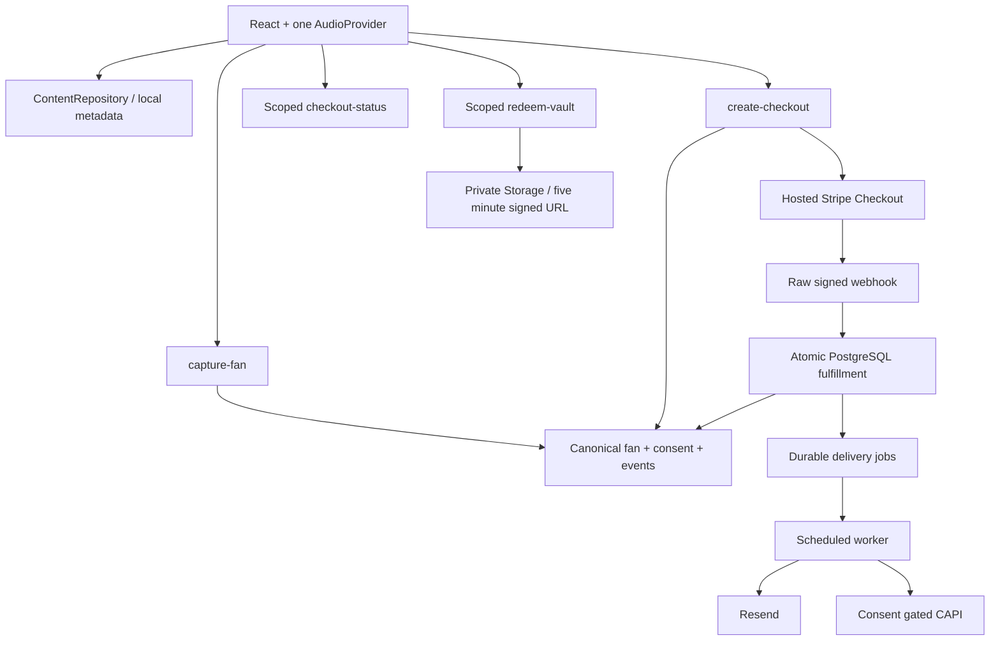

# Phase 1 architecture

The October 23 master prompt governs implementation; see `docs/IMPLEMENTATION_PLAN.md` for checklist conflicts and initial assessment. Vite, React Router, local content repository, GSAP and the single native AudioProvider remain. Provider SDKs run only in Supabase functions. The browser uses typed JSON endpoints and handles failures without inventing success.

## Boundaries and entities

`supabase/shared/catalog.json` is the one public catalog used by the frontend and server. Server code selects prices from its deployed copy; a request cannot set a Vault price. Release metadata stays in `src/data/content.ts` behind `ContentRepository`. Private object paths are exclusively `PRIVATE_FILE_PATHS` secrets.

`fans` uniquely identifies normalized email within the canonical artist scope. Public capture can append activity but cannot read purchases, set verified identity, merge a phone, change a verified profile, revoke permission, or grant an unlock. Email case/whitespace normalization does not remove dots or plus aliases. All existing channels are email; WhatsApp is deliberately unavailable pending an approved verified-phone adapter. This is not a multi-tenant authorization implementation.

`consent_records` records pending/granted/revoked channel permissions, disclosure version, source, and timestamp. A checked email-marketing box requests confirmation; only a signed link delivered to the inbox grants permission and establishes email verification. Unchecked checkout is transactional contact only. Repeated opt-in must not downgrade an already granted permission. `fan_events` records logical actions with unique event IDs; application handlers only insert. SQL operator access remains privileged and audited operationally.

`capture_requests` makes capture retries safe. `checkout_attempts` holds amount, purpose, immutable request ID, Stripe session, expiry and status. No global fan abandonment flag exists. `purchases` uniquely identifies the attempt, session, and payment intent. `vault_unlocks` uniquely identifies artist/fan/item; tips never create it. Full refunds revoke access unless another unrefunded purchase maintains the same item; partial refunds retain access.

`webhook_events` is written in the same transaction as purchase, grant, canonical events and outbox jobs. A failed transaction rolls back the receipt so Stripe can retry. A current Stripe session is retrieved before processing; completion while unpaid grants nothing. Async success, failure, expiry and refunds are handled. Expiry cannot downgrade a completed attempt. Refunds arriving before purchase return retryable failure rather than disappearing.

`delivery_jobs` separates durable fulfillment from external side effects. Workers claim ten rows with SKIP LOCKED, two minute leases, six attempts and exponential backoff. Bodies are frozen before email sends; Resend receives a stable idempotency key. Provider acceptance is stored as `sent`; this does not prove inbox delivery. Worker retries require an active schedule. Cross-system exactly-once email delivery is not claimed.

## Access and recovery

HMAC SHA-256 signed capabilities are scoped by artist, subject, purpose, issue/expiry time. Capture (30 min) authorizes creation of a new checkout, never existing entitlement access. Status (7 days) exposes only one attempt. Paid status may issue a 15 minute access token; email links issue 48 hour purchase access tokens. Redemption rechecks purchase and active entitlement, then signs the exact private object for five minutes. Free reward tokens cannot redeem a purchase. Tokens travel in URL fragments and are removed on entry; a session-scoped copy supports reload. Closing the dialog clears that copy. Email recovery returns the same public response whether the email is known or unknown.

## Attribution and measurement

Only bounded campaign labels are retained, with no arbitrary query strings, contacts, or URLs. Anonymous local attribution expires after 30 days; storage denial falls back to memory. First meaningful campaign is retained, latest meaningful context updates separately. Database capture preserves first touch and updates last touch. Anonymous DSP clicks are not attached to a known fan.

Pixel and CAPI require a separate optional measurement control. Lead uses `capture:<request>`, checkout uses `checkout:<attempt>`, purchase uses `purchase:<purchase>`, unlock uses `unlock:<purchase>`. Lead/checkout are browser + outbox with the same IDs; Purchase is browser + outbox; VaultUnlock is server only. PageView/DSPClick use matching browser/server request IDs. No tracking initializes without permission. No tokens, raw email/phone or arbitrary URLs are put in Pixel parameters. Server advanced matching hashes normalized email. Measurement consent is an action/checkout snapshot, separate from email marketing confirmation. The browser retains scoped revocation capabilities and can cancel pending CAPI jobs and disable future measurement for its attempts. New activity honors withdrawal; already accepted/sent provider events cannot be recalled. See privacy review for limitations.

## Operational scaling

Database uniqueness/row locks secure retries and concurrent writes. RLS and revoked table/RPC grants prevent direct browser access; service functions enforce artist scope. Rate buckets use salted IP digests and per-contact digests. No Redis, broker, CMS, login dashboard, or recurring billing is introduced. Future artist tenancy and contact verification require further authorization work.
